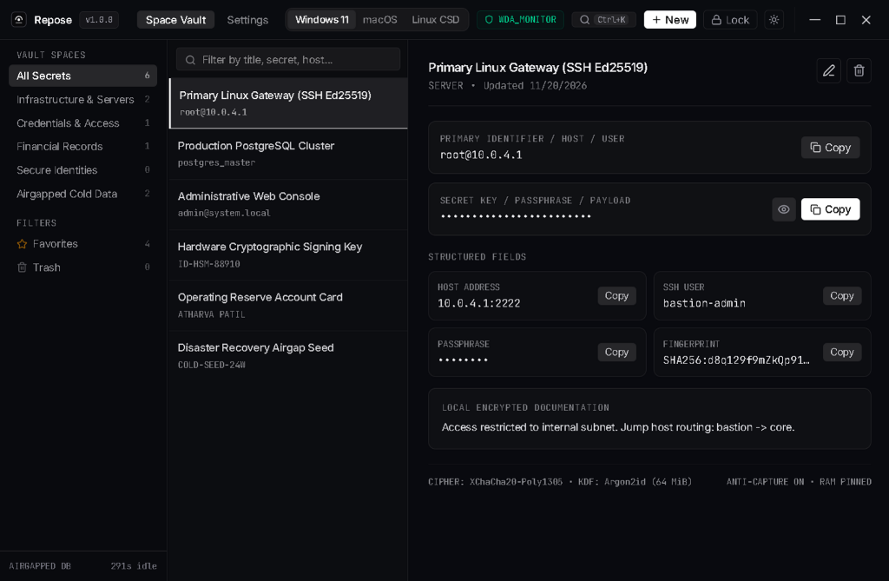
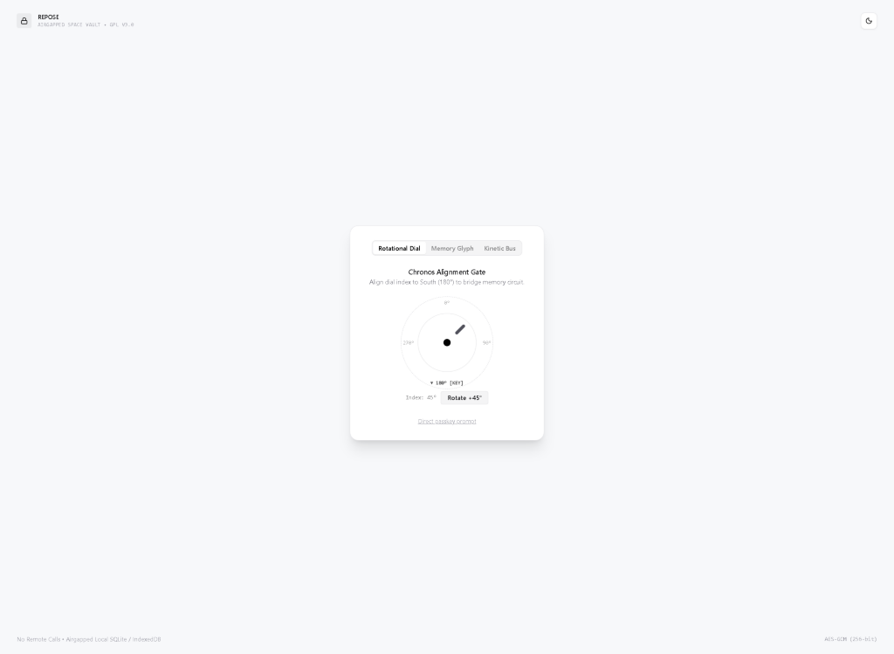
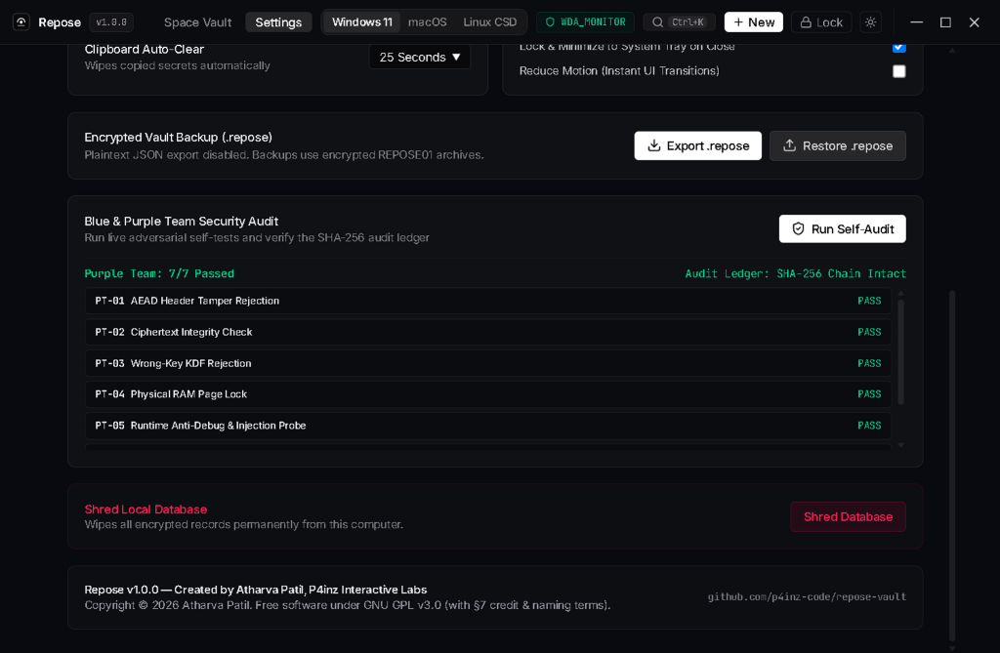

<p align="center">
  
</p>

<h1 align="center">Repose</h1>
<p align="center"><b>Everything you protect, in one calm vault.</b><br>A free, open-source, airgapped space vault for passwords, SSH keys, API tokens, databases, and cold seeds. Zero cloud, zero network calls.</p>

<p align="center">
  <a href="https://github.com/p4inz-code/repose-vault/releases/latest"></a>
  <a href="https://github.com/p4inz-code/repose-vault/releases"></a>
  <a href="https://github.com/p4inz-code/repose-vault/stargazers"></a>
  <a href="LICENSE"></a>
</p>

---

Repose is a secret vault for what belongs only on your own computer: server logins in one space, API keys in another, financial records and 24-word cold seeds somewhere else. It keeps all of it in one calm, fast window, encrypted on disk with **Argon2id** and **XChaCha20-Poly1305**.

The interface is drawn by Repose itself, so there are no clunky native dialogs, no browser extensions, and no cloud sync servers. There is a crisp light and dark theme, keyboard-first navigation (`Ctrl+K` quick jump, `Ctrl+N` new record, `Ctrl+L` instant lock), and a strict **zero-network invariant** (`connect-src 'none'`). Nothing ever leaves your machine.

---

## Get Repose

Download the setup file for your system from the [latest release](https://github.com/p4inz-code/repose-vault/releases/latest). Every release includes a `SHA256SUMS.txt` file so you can verify the installer offline before running it.

- **Windows 11 / 10 (x64):** `Repose-Setup-1.0.0.exe` (5.3 MB).  
  Run it. It unpacks and launches Repose's own custom setup wizard, installs **for your user only** (`%LOCALAPPDATA%\Programs\Repose`), and needs **no administrator rights**.
- **macOS & Linux:** Cross-platform core & titlebar framing are built into the codebase; see [Build from source](#build-from-source) below.

> **Custom Uninstaller & Data Safety:** When you uninstall Repose from Windows Settings or run `repose.exe --uninstall`, the uninstaller asks whether to **keep your encrypted `vault.repose` file** in `%APPDATA%\Repose` (so you never lose your passwords on reinstall) or permanently shred it.

---

## A Quick Tour

<table>
<tr>
<td width="50%" align="center">
<sub>Clean Unlock Screen (Keyboard PIN, Passphrase, Recovery &amp; Biometrics)</sub><br><br>

</td>
<td width="50%" align="center">
<sub>Cross-Platform Shell &amp; OS Security Controls</sub><br><br>

</td>
</tr>
</table>

### What you get inside

- **Spaces & Universal Records:** Organize secrets into *Infrastructure & Servers*, *Credentials & Access*, *Financial Records*, *Secure Identities*, and *Airgapped Cold Data* — with custom key-value fields, live TOTP 2FA codes, and encrypted markdown notes.
- **Type Your PIN on Your Keyboard:** On the Quick PIN screen, type `0–9` directly on your keyboard (plus `Backspace` and `Escape`) or click the keypad — no mouse required.
- **Auto-Clearing Clipboard:** Copying any secret starts a 25-second countdown and wipes the clipboard automatically afterward.
- **Encrypted Backups Only:** Plaintext JSON export is disabled by design. Backups export as encrypted `REPOSE01` archives so decrypted secrets never touch disk.
- **Close Means Lock:** Clicking `[X]` on the main window immediately locks the vault, scrubs keys from RAM, and minimizes to the System Tray.

---

## Security & Defense Model

Repose is built security-first with **Red, Blue, and Purple Team** defenses compiled directly into the Rust core:

| Layer | Protection |
| :--- | :--- |
| **2-Tier Key Hierarchy** | A random 256-bit Vault Master Key (VMK) encrypts your data and is wrapped into independent `Argon2id` ($64\text{ MiB}$, $t=3$, $p=4$) + `XChaCha20-Poly1305` key slots. |
| **Anti-Screen Capture** | Uses Win32 `SetWindowDisplayAffinity(WDA_EXCLUDEFROMCAPTURE)` on Windows so screen recorders, OBS, and spyware capture only a black box. |
| **Anti-Debug & RAM Pinning** | Detects `IsDebuggerPresent()`, `CheckRemoteDebuggerPresent()`, and Linux `TracerPid` to zeroize keys and lock cleanly; pins key pages in physical RAM via `VirtualLock` / `mlock()` to keep them out of swap/pagefiles. |
| **Crash-Safe Atomic Saves** | Writes to `vault.repose.tmp`, flushes with `sync_all()`, rotates 5 rolling `.bak` snapshots, and atomically renames. |
| **Blue Team Audit Ledger** | Every lock, unlock, failure, and security event is recorded in a local SHA-256 hash-chained `audit.ledger` with exponential-backoff brute-force throttling. |
| **Purple Team Self-Audit** | Open **Settings → Blue & Purple Team Security Audit → Run Self-Audit** at any time to run 7 live adversarial tests (`PT-01` through `PT-07`) verifying tamper rejection, memory locking, and clean-room execution. |

---

## Privacy

Repose works **100% offline**. All vault data, rolling backups, and audit logs live locally on your own disk (`%APPDATA%\Repose` on Windows, `~/Library/Application Support/Repose` on macOS, `~/.local/share/repose` on Linux). Fonts (`Inter` and `JetBrains Mono`) are bundled locally inside the app, and Tauri's Content Security Policy enforces `connect-src 'none'`. There is no update checker, no analytics, and no telemetry.

---

## Build from source

Everything needed is in this repository.

**Prerequisites:** Node.js 20+, `pnpm`, Rust toolchain (`1.80+`), and Inno Setup 6 (on Windows to package `Repose-Setup-1.0.0.exe`).

```powershell
pnpm install

# Run Rust crypto, I/O, Blue Team & Purple Team tests
cd src-tauri
cargo test
cd ..

# Build the release binary + Repose-Setup-1.0.0.exe + SHA256SUMS.txt
powershell -ExecutionPolicy Bypass -File .\scripts\build-setup.ps1
```

---

## Support and feedback

- Bugs and ideas: [open an issue](../../issues/new/choose)
- Security issues: see [SECURITY.md](SECURITY.md)

## License and credit

Repose is free software under the **GNU General Public License v3.0** ([LICENSE](LICENSE)), with section 7 additional terms about credit and naming ([ADDITIONAL_TERMS.md](ADDITIONAL_TERMS.md)).

You can use it for anything, free of charge, including at work. You can study it, change it, and share it, modified or not. If you share a version, you must keep the author credit ("Created by Atharva Patil, P4inz Interactive Labs") and copyright notices, keep the source open under GPLv3, and give any modified version its own name instead of "Repose".

Third-party components keep their own licenses: [THIRD_PARTY_NOTICES.md](THIRD_PARTY_NOTICES.md) · [PRIVACY.md](PRIVACY.md) · [SECURITY.md](SECURITY.md).

Copyright © 2026 Atharva Patil, [P4inz Interactive Labs](https://github.com/p4inz-code).
